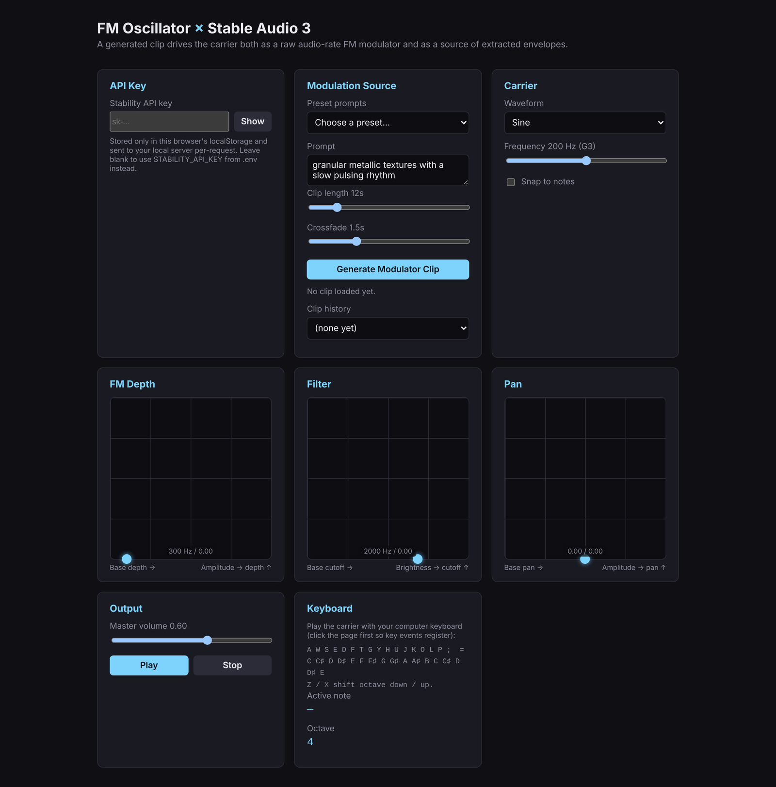

# FM Oscillator × Stable Audio 3

A real-time FM synthesizer whose modulator is a generated Stable Audio 3 clip.
The clip drives the carrier two ways at once:

- **Audio-rate**: the raw waveform is looped and fed directly into the
  carrier's `frequency` AudioParam (classic Web Audio FM, no custom DSP).
- **Control-rate**: an RMS amplitude envelope and a spectral-centroid
  ("brightness") envelope are extracted from the clip and used to modulate
  the FM depth, filter cutoff, and stereo pan, phase-locked to the clip's
  loop.



## Try it

**Hosted:** https://maxfieldhulkersai.github.io/fm-oscillator/

The hosted version calls `api.stability.ai` straight from your browser, so
you have to paste your own Stability API key into the API Key field. The key
is kept in your browser's localStorage and is never sent anywhere except
Stability. Get a key at https://platform.stability.ai/account/keys.

**Local:**

```
npm install
cp .env.example .env   # optional: set STABILITY_API_KEY so you don't have to paste it in the UI
npm start
```

Open http://localhost:3000.

## How it's wired

- `server.js` — Express static file server plus a thin proxy for two Stability
  endpoints (`text-to-audio`, `results/:id`). When you run locally the key
  comes from `.env`, or from the UI field (sent per request in an
  `x-stability-key` header). The UI field wins if both are set.
- `public/audio/stableAudioClient.js` — submits a generation request and
  polls until the clip is ready (generation is asynchronous, typically
  several seconds to about a minute). On load it probes `/api/health`: if
  the proxy answers it goes through the proxy, otherwise it talks to the
  Stability API directly. That is what makes the same `public/` folder work
  both behind `server.js` and on a static host like GitHub Pages.
- `public/audio/analysis.js` — extracts the RMS and spectral-centroid
  envelopes from the decoded clip.
- `public/audio/envelopeScheduler.js` — schedules those envelopes onto
  AudioParams in sync with the clip's loop boundaries.
- `public/audio/fmEngine.js` — the actual Web Audio graph: carrier
  oscillator, dual crossfading modulator chains (so a new clip fades in
  without clicks), filter, and panner.
- `.github/workflows/pages.yml` — publishes `public/` to GitHub Pages on
  every push to `master`.

## Notes

- Clip length defaults to 12s. Short loops make more sense as a modulator
  than the API's 380s ceiling.
- The "amount" sliders blend between a constant base value (0) and the base
  fully tracking the envelope (1). They only take effect once a clip has
  been generated.
- Pad/slider changes to the depth/filter/pan envelopes apply immediately,
  splicing into whatever's left of the current loop rather than waiting for
  it to wrap. See `envelopeScheduler.js`.
- No API key is stored in this repository. `.env` is gitignored; copy
  `.env.example` to create yours.
